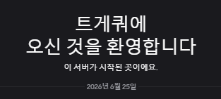
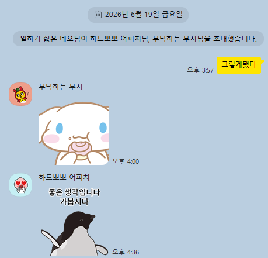
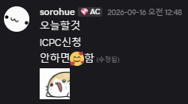
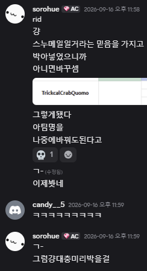

2026-2027 시즌 ICPC에 참가했습니다. 본선을 잘 봐서 기분이 좋은 김에 팀 빌딩 시점부터 복기합니다.

## 이게뭔팀인데

작년 ICPC에 `ThirdHighSchool` 팀으로 참가했습니다. 작년 대회 후기를 썼어야 됐는데 까먹고 안 써서 기록이 없는데 꽤 괜찮은 성적을 받았습니다(UCPC 6th, ICPC Korea Regional 8th(National 5th, Silver Awards)).

ICPC가 끝나고 저희 팀을 이긴 `Ssalhur`로 `jjang36524`님이 영입됨에 따라 한 자리가 비었습니다. 자리가 빈 시점에 작년 대회가 끝나고 팀이 공중분해된 `terrasphere`나 `lulusphere`나 `892437_`이나 `saturnalorbit` 중에 한 명을 납치하면 되겠거니 하고 있었습니다. 바로 확정을 하지는 않고 은근슬쩍 어필만 몇 번 해뒀습니다.

6개월이 지났습니다. UCPC 팀을 짜야 합니다. 그때까지 진짜로 어필만 하긴 했는데 다행히 다른 팀이 먼저 납치해 가지 않아서 백만년 만에 `terrasphere`가 정식으로 팀에 합류했습니다.

팀명은 지난 5월 개최된 SCSC 프로그래밍 경시대회의 [이 문제](https://atcoder.jp/contests/scpc2026-div1/tasks/scpc2026_div1_i)에서 가져왔습니다. 팀원은 아래와 같습니다.

- **트**(`sorohue`): 트릭컬리바이브를 담당합니다. 저능합니다. 대체로 문제를 `게`와 `쿼`에게 넘기고 가스라이팅합니다.
- **게**(`heeew`): 게춤추는영상을 담당합니다. 고능합니다. 대체로 `트`와 `쿼`가 못 푼 문제를 잘 풉니다.
- **쿼**(`terrasphere`): QuomodocunquizE를 담당합니다. 고능합니다. 대체로 `트`와 `게`가 못 푼 문제를 잘 풀게 됩니다.

## UCPC 2026

팀연습은 예선으로 하고 본선에 나갔습니다.

예선은 스코어보드를 보니 괜찮게 친 것 같습니다. 0WA로 깨끗한 한 줄을 얻었습니다.

본선은 개처망했습니다. 이건 고생대 급으로 옛날이라 기억이 가물가물합니다. ICPC 후기에 필요한 내용만 쓰면, CD 풀고 저능행동하다가 `게`랑 얘기하면서 H 관찰 좀 만들었을 때 그냥 그걸로 브포 딸깍하면 되겠는데? 를 주장하고 `게`가 짜서 맞아오게 가스라이팅을 했습니다. `쿼`는 G에서 기하의 참맛을 느끼고 장렬히 전사했습니다. 명복을 빕니다.

상품으로는 `게` 캐리로 독거미를 받았습니다. 전사한 `terrasphere`는 `lulusphere`로 교체되었습니다.

## ICPC 신청하기

3개월이 지났습니다. ICPC를 신청하지 않으면 대회에 나갈 수 없음을 깨달았습니다.

신청을 하는 건 필요한 개인정보를 UCPC 신청할 때 대충 다 알아내서 간단했습니다. 문제는 참가 신청을 하려면 팀명을 정해야 했습니다.

팀명 규정을 보니 영어 24자 이하로 지으라고 해서 어떻게 짓징 하고 백만년 동안 고민을 했습니다. 결과적으로 정하는 데 실패해서 LLM의 힘으로 신청 마감 N분 전에 영문 팀명을 뽑아내서 신청을 했습니다. 그렇게 **TrickcalCrabQuomo**로 영문 팀명이 결정되었습니다.

아니 근데 팀명을 나중에 정해도 됐대 이럴수가

## 팀연습 1 (Latin America Champoinship 2026)

팀 만들고 일억만년만에 예선용 팀연습을 했습니다. 여기부턴 엄청나게 원시시대는 아니라 약간의 복기가 가능합니다.

- 12문제 셋입니다. `트`가 앞, `게`가 중간, `쿼`가 뒤 4문제를 받았습니다.
- 각자 풀어야 되는 문제들을 풀었습니다. (`게` E 0:10, `트` B 0:17, `쿼` J + 0:22, `쿼` I + 0:40, `트` D + 0:53, `게` F +1 1:03)
- A를 못 풀겠어서 `게`한테 던지고 쉬우니까 짜라고 가스라이팅했습니다. `게`가 가지고 있던 문제에서 H를 훔쳤습니다. 근데이럴수가 자명 NTT 센분 뭉탱이야 그래서 H랑 식정리 여정을 떠났습니다.
- `쿼`가 L을 풀고 나타났습니다. 슼보를 보는데 아무래도 고능한 것이 분명합니다. (`쿼` L + 1:36)
- 사실 A는 안 쉬웠습니다. `게`랑 A 논의를 좀 하고 `쿼`랑도 K 논의를 좀 했습니다.
- `게`가 A를 풀고 G 개재밋네 윽윽윽 하더니 G도 풀어왔습니다. 아무래도 고능한 것이 분명합니다. (`게` A + 2:28, G +2 2:44)
- `쿼`의 K 풀이에 관찰 하나만 슬쩍 얹어놓고 아 다풀렸네 걍짜라 하고 `쿼`를 가스라이팅했습니다. `쿼`는 K까지 맞아와서 본인 앞에 있던 문제를 다 털었습니다. (`쿼` K + 3:07)
- `트`가 백만년 만에 머신을 잡고 H를 짰습니다. 짜다가 중간에 식정리에 똥 싼 걸 발견해서 고치고 맞았습니다. (`트` H + 3:39)
- C만 남았는데 똥기하라 도망갔습니다. 대회 끝나고 나머지 두 명이 업솔빙했습니다. (`게쿼` C upsolved)

## ICPC Seoul Regional National First Round

약칭 인터넷예선 약약칭 인예입니다. 프린터까지 가기가 귀찮아서 팀노트를 인쇄하지 않는 대형 응가와 프린터가 실제로 망가져서 대회 중 코드 프린트가 안 된다는 이슈를 안고 쳤습니다.

- 인예는 쉬운 편인 문제 3개가 한국어로 주어집니다. 하나씩 나눠서 보기로 했습니다. G를 받아서 빨리 짜려다가 초대형 응가를 싸고 인생이 망했습니다. (`트` G +5 0:30)
- 그동안 `게`가 진짜로 개쉬운 K를 넘겨줘서 그냥 중간에 빨리 짜서 던졌습니다. (`트` K + 0:16)
- 프린트가 안 되던 관계로 창을 두 개 열어서 `게`가 A를 짜는 동안 G를 옆에서 동시에 디버깅했습니다. A도 G랑 비슷한 시점에 풀렸습니다. (`게` A +1 0:35)
- `쿼`와 `게`가 각각 H와 J를 썰어왔습니다. (`쿼` H + 0:43, `게` J + 0:54)
- `쿼`는 C를 N분에 걸쳐 이해하고 M초 만에 엥 그냥하면되네 선언 후 짜서 맞았습니다. (`쿼` C + 1:02)
- `트`가 D가 개쉽다고 주장하고 짜서 틀리고 틀리고 틀리는 응가를 싼 후에 맞았습니다. 진짜 개멍청하게 출력을 잘못해서 틀린걸 못 찾았다는 이슈가 있었습니다. 그동안 `게`가 B 풀이를 완성해서 맞았습니다. (`게` B + 1:44, `트` D +3 1:48)
- 남은 문제들을 셋이서 적당히 돌려가며 핥다가 `게`가 E를 좀 오래 잡더니 IQ로 뚫었습니다. `게`는 E가 걍쉽다는 스캠을 설파 중입니다. (`게` E + 2:16)
- F는 셋이서 이상한 풀이를 냈는데 못 짰습니다. 팀노트가 있었으면 KMP 보고 걍 대충 풀었을 거 같긴 합니다.
- I는 풀이에 필요한 모든 관찰이랑 지식이 다 있었는데 보스니까 못풀겠거니 하고 약간 정신적으로 대충 봐서 못 푸는 응가를 쌌습니다.

근데 뭐 이렇게 열심히 망해도 본선을 가니까 그냥 그러려니하고 팀연습한 셈 치기로 했습니다. 사실 제일 큰 똥을 싼 사람이 이런 주장을 해도 되는지 모르겠습니다. 근데 팀원 제의를 제가 했으니까 저 아니면 이 팀으로 대회 못 나왔을 테니 결국 제가 inf퍼포를 기여한 게 아닐까요???

라고 하면 안 되겠죠.

이쯤에서 제가 느낀 제가 대회 중에 할 수 있는 좋은 행동은 이 정돈 거 같습니다.
- 배열 위에서 조작하는 IQ 문제를 `게`한테 첫 관찰이랑 같이 던지기
- 템플릿벅벅/아는 문제 풀기
- `게`의 풀이가 증명 안해도 대충 맞다고 가스라이팅하기
- `쿼`의 풀이가 대충 빠르다고 가스라이팅하기
- 머신 빈 김에 뭐라도 짜라고 가스라이팅하기

예선 이후부터 본선까지의 후기는 Pt. 2로 이어집니다.

쓰다 보니까 복선들이 좀 보여서 재밌네요.