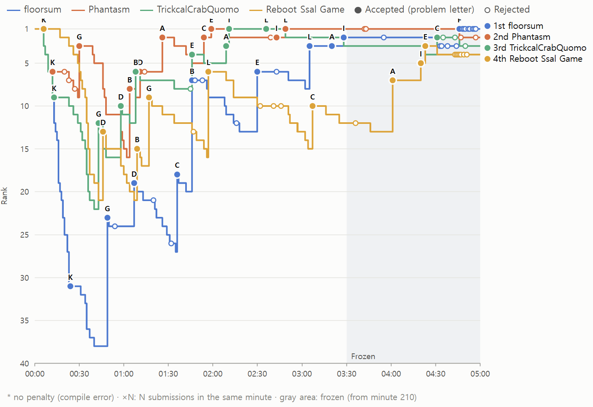
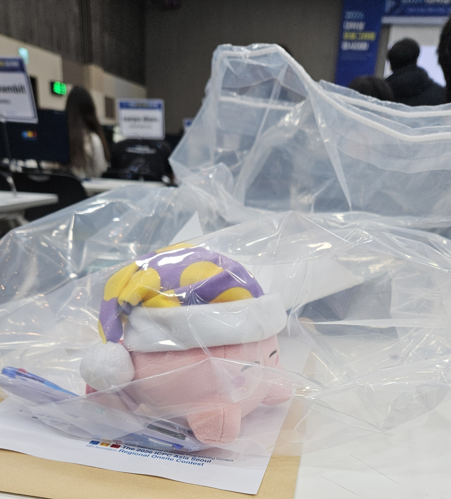
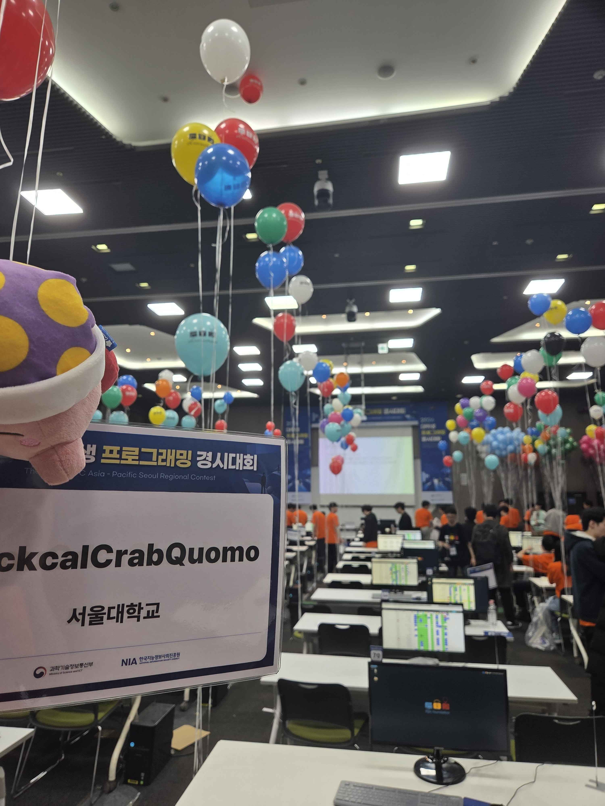

- **트**(`sorohue`): 트릭컬리바이브를 담당합니다. 가스라이팅을 합니다. 대체로 쉬워 보이는 문제를 먹다 폭사합니다.
- **게**(`heeew`): 게춤추는영상을 담당합니다. IOI 메달이 있습니다. 대체로 자구나 해구성을 먹게 됩니다.
- **쿼**(`lulusphere`): QuomodocunquizE를 담당합니다. 깔끔기하 수련으로 강해졌습니다. 대체로 기하를 먹게 됩니다.

## 16th KAIST Mock Competition

약칭 카이목입니다. 개처망했습니다.

- `트``게``쿼`순으로 적당히 1/3씩 가져갔습니다. 앞 문제를 쭉 보는 데 쉬운 게 없어서 죽음을 경험했습니다. `쿼`도 M을 썰고 나서 비슷한 상황이였던 거 같습니다. (`트` F + 0:19, `쿼` M + 0:36)
- AB는 풀 자신이 없었고 `게`가 잘 풀 거 같이 생긴 C는 `게`한테 던지고 D랑 E를 깔짝였습니다. `쿼`는 H와 좋은 승부를 하러 갔습니다. `게`는 C에 계속 박았습니다. 이때 막 한 번에 제출할 만한 코드가 다 짜지진 않았고 서로 아이거 일케짜면 되네 할 때 머신을 뺏는 식으로 해서 코드 3개가 병렬로 구현된 거 같습니다. 각각 적당한 코드가 완성돼서 C D를 해결했습니다. D는 인덱싱을 개멍청하게 해서 똥 코드를 짰다가 중간에 밀고 새로 짰습니다. (`트` D + 1:48, `게` C + 1:58)
- `쿼`는 H에서 디버깅 이슈로 죽음을 경험하고, `게`는 G에서 센분 힘의길 풀이를 냈다가 홀짝성을 고려 안해서 죽음을 경험하고 있었습니다. `트`는 이때부터 I와 L을 깔짝였습니다.
- `쿼`가 문제를 줄 때 L의 대강의 아이디어를 줬는데 그거 갖고 디벨롭에 실패해서 버리고 더 많이 풀린 I로 도망갔습니다. 근데 그게 디벨롭이 되는 아이디어였어 이럴수가
- `게`와 `쿼`가 각각 G와 H에서 탈출했습니다. 저는 이때 `게`의 지시 하에 I에서 쓸 수 있는 패턴을 그냥 뇌 빼고 생성하고 있었습니다. (`게` G + 3:30, `쿼` H +2 3:35)
- I의 풀이가 한 80퍼 정도 나온 시점에서 시간이 얼마 안남아서 `게`가 머신을 잡았다가 짜는 도중에 폭사했습니다. I랑 L 중에 L을 골랐으면 풀었을 수도 있겠다는 생각은 있는데 쩔수없 + 풀어도 등수가 안바뀌었다는 빨간약이 있었습니다.

하지만 개처망한 것 치고 5등이면 나쁘지 않다???입니다.

### 마노사바

대강 이때쯤 마노사바를 샀습니다. 마노사바 후기는 아마도 다른 글로 올라옵니다.

## 팀연습 2 (APAC 2026)

카이목 치고 멘헤라가 와서 팀연습을 돌았습니다. 팀연습과 같은 시점에 다른 팀이 어떤 대회의 테스팅을 돌았고 롤드컵이 열려서 각각 관전하면서 팀연습을 돌았습니다. `쿼`도 아마 본 것 같은데 마이크에 수음되는 찐빠가 나서 갈!을 했습니다.

- 문제 배분을 했습니다. A를 읽자마자 인예 F의 향을 맡고 버렸습니다.
- 각자 풀어야 되는 문제를 하나씩 풀었습니다. (`쿼` K + 0:22, `트` C +1 0:30, `게` H +1 0:31)
- 게임 냄새 맡은 `쿼`가 포탈타고 달려와서 B를 훔쳐갔다가 돌려주고 E를 훔쳐갔습니다. `게`는 J를 훔쳤습니다. `트`는 돌려받은 반쯤 풀린 B를 마무리해서 냈습니다. (`게` J + 0:51, `트` B +1 1:10, `쿼` E + 1:34)
- `게`가 F를 풀다가 곱의 합 꼴을 개빨리 구하면 적당히 되겠는데 어쩌구저쩌구를 주장했습니다. FFT 슬롭 걸렸나 해서 `게`랑 좀 얘기를 했더니 진짜로 FFT 딸깍으로 구해지는 합 꼴이였습니다. `게`가 FFT 문제를 푼 적이 없어서 쓰는 방법이랑 다항식으로 바꾸는 방법 정도만 알려주고 가스라이팅을 했습니다. 팀노트의 FFT 템플릿이 N=1일 때 작동을 안했다는 개찐빠를 내긴 했는데 어찌저찌 잘 풀었습니다. (`게` F +2 2:04)
- `트`가 HLD 슬롭 D에 걸렸습니다. HLD를 `게`한테 던지고 F를 받아올까 헀는데 그냥 `게`가 F를 짜는 게 `트`가 F를 완전히 이해하는 것보다 더 빠를 것 같아서 그냥 D를 (`게`의 원성을 뒤로 하고) 직접 짰습니다. (`트` D + 2:50)
- `게쿼`는 그동안 IL이랑 멸망전 중이였는데 저는 식조작 똥같이 생긴 I를 훔쳐서 멸망전에 돌입했습니다. 그러고 좀 지나서 `게쿼`가 이상해 보이는 기하인 L의 풀이를 내면서 구현을 돌렸습니다.
- 백만 가지 식조작 노기디를 하다가 번개가 쳐서 I 풀이가 나왔습니다. 대충 이항 계수 다항식?으로 조작을 하면 되더라였는데 짜기 귀찮아서 `게`한테 풀이 설명해 주고 짜기 쉽다고 가스라이팅을 했습니다. 이때쯤 L이 풀려서 (`쿼` L + 4:07) `게`가 열심히 I를 짜고 풀어왔습니다. (`게` I + 4:45)

`쿼`가 제가 처음 납치해야지 할 때쯤 생각했던 것보다 기하 구현을 잘 밀더라 하는 생각을 했습니다. 팀이 생각보다 더 쎄 이럴수가 이건돼

## 본선

### 예비소집

`게`랑 킨텍스 근처에서 카이센동을 먹고 대회장으로 갔습니다. 저는 해산물을 잘 안 먹는데 덕분에 평상시의 100배쯤 되는 체내 해산물 농도를 얻었습니다.

예소 문제는 어차피 작년 문제니까 대충 하나 풀고 TL 테스팅을 좀 했습니다. 1초에 나머지 연산 3억 번인가 뭐 대충 그랬던 거 같습니다.

`게`가 vscode 세팅을 하다가 실행을 할 때마다 빌드를 하는 게 귀찮아서 빌드 한 번만 하는 버튼을 만들려고 시도했지만 실패했습니다.

작년에 키보드가 개불편하다는 이슈를 당해서 이번에는 그런 상황을 대비해 비상용 키보드를 들고 가려고 했습니다. ICPC 규정이 빡빡해서 그런 키보드가 집에 있나 했는데, 카이목에서 받은 독거미가 ICPC 규정에 맞았습니다 이럴수가

예비소집이 끝나고 `쿼`를 포함하는 어떤 팟에 껴서 샤브를 먹었습니다. 팟에 건비가 개많아서 샤브육수가 육즙에 가까운 무언가로 진화하길래 `qvix` 님이랑 야채를 좀 부었습니다.

돌아가는 길에 젓뮤 컴필이 나왔대서 돌렸습니다.

### 본대회

기숙사로 돌아가서 일찍 잤습니다. 근데 엄청커다란벌레가나의발을물어서 새벽 2시에 깼습니다 ㄱ-. 킨텍스로 가면서 산만한시선을 돌렸습니다.

맨 뒷자리에 걸렸습니다. 뒤에 사람이 없어서 자리 이동이 편했습니다.

대회장에 들어가서 보니까 키보드가 없었습니다. 개인 키보드를 들고 가면 기본 키보드를 치우는 구조였대요 이럴수가

그래서 일단 기본 키보드를 써보고 똥이면 가져온 키보드로 바꾸려던 게 그냥 가져온 키보드를 쓰는 걸로 되었습니다.

- 13문제 셋이였습니다. 배분을 했습니다. 결과론적으로 이번에는 제가 받은 문제가 다 풀 만한 문제였고 그래서 팀원들한테 다 뿌려졌습니다.
- A를 읽었는데 할만해 보였고, B도 할만해 보였고, C는 깡수학 같이 생겨서 좀 나중에 진득하게 보기로 했습니다. 리쌀겜이 K를 퍼솔해서 슼보 보고 `쿼`가 `게`에게 K를 던지고 금방 해결했습니다. (`게` K + 0:13)
- `게`는 `쿼`한테 G를 던졌습니다. 둘이 적당한 풀이 토의를 하더니 `쿼`가 G를 짜기 시작했습니다. 저는 그동안 A를 `게`한테 던져버리고 가스라이팅을 좀 한 뒤 C의 식조작을 했습니다. (`쿼` G + 0:43)
- G를 풀고 나니 BD가 풀려 있었습니다. E는 기하라 안봤어서 DE를 방금 G 짠 `쿼`한테 주고 B를 똑바로 풀었습니다. BD 둘다 풀이가 금방 나와서 빠르게 치웠습니다. (`쿼` D + 0:58, `트` B + 1:08)
- `쿼`가 E를 풀다가 오목다각형 내부 점 판정이 팀노트에 없어서 울고 직접 짜서 맞아왔습니다. (`쿼` E + 1:46)
- `게`가 먼옛날 읽은 I를 게임이라고 저한테 던져줬습니다. 대강의 분석을 금방 끝내서 A를 짜던 `게`를 밀어내고 짧은 코드를 하나 짜서 냈는데 틀렸습니다 이럴수가
- 멍청하게 복잡한 케이스 분석을 했다는 걸 깨닫고 깔끔한 전략을 내서 증명까지 했습니다. 그때 막 `게`가 A를 다 짜서 맞았고, I도 바로 고쳐서 맞았습니다. 이 시점부터 잠깐 동안 1위였습니다. (`게` A + 2:09, `트` I +1 2:11)
- I를 분석하는 동안 옆에서 L을 풀던 `쿼`가 네제곱 스케일인데 2400만을 넘는 데이터를 못 만들 거라는 주장과 함께 뭔가 풀이를 만들었길래 구경을 했습니다. (이때 이 문제가 AVX 밴의 원인이겠거니 어쩌구라는 얘기도 했던 거 같습니다.) 걍 대충 돌 거 같고 머신도 비었으니 일단 짜보라고 가스라이팅을 했습니다.
- 좀 지나서 `쿼`가 일단 다 짰는데 돌지 모르겠다고 했습니다. `쿼`가 기하를 꽤 잘 짜는 거 같아서 저는 걍 돌 거 같았기 때문에 제출하라고 가스라이팅을 했습니다. 제출했더니 맞아서 판타즘이랑 차이를 좀 벌렸습니다. (`쿼` L + 2:36)
  - AIL 라인을 팀 안에서 역대급 스캠 라인이라고 부르고 있습니다. 각자 걍 자기 푼 문제에 쉬운 데 왜 못풀지 x3을 주장했음... 
- C에 총력전을 했고 **인생이 망했습니다**. 대충 어떤 일이 있었냐면,
  - 시작하고 1시간쯤 됐을 때 만들었던 식 쪼가리를 들고 돌아왔습니다.
  - 적당한 더블 카운팅으로 ${\cal O}(k)$개의 복잡한 항이 나왔습니다.
  - 정리를 하니까 ${n \choose 2i}x^i$ 꼴의 무언가가 나왔고 `게쿼`가 생함을 들고 와서 $(1+\sqrt{x})^m+(1-\sqrt{x})^m$ 꼴의 식을 끓였습니다.
  - 근데 여기서 $\sqrt{x} \mod M$을 직접 찾아서 계산할 생각을 해서 이산 제곱근이 필요하다고 3명이 다같이 할루시를 먹었습니다.
  - 팀노트에 토넬리-샹크스 템플릿이 없었기 때문에 그냥 재발명을 하자는 초대형 응가행동을 해서 3명 전원이 1시간 넘게 태웁니다.
  - 적당히 구하는 코드를 짜고 보니까 이산 제곱근이 모든 수에 대해 존재하는 게 아니여서 예제 3이 안 나온다는 빨간약을 먹어버렸습니다.
  - 그러다가 걍 실수로 짜고 mod로 적당히 실수부를 날려버리자는 얘기를 하다가 화장실을 갔습니다.
  - 화장실을 갔다 왔더니 `게`가 그냥 $\sqrt{x}$를 수치화를 안 하면 아무 문제가 없다는 빨간약을 먹고 코드를 짜고 있었습니다.
  - 근데 다짰더니 답이 안나와 이럴수가
  - 처음 한 식조작에 마이너 응가가 있었습니다. 그렇다고 방법론이 크게 바뀌는 건 아니고, 그냥 포배를 하겠답시고 만든 이상한 범위 제한을 풀어버려도 답이 안바뀌어서 식이 백만배 간결했었다더라 하는 이슈였습니다. (`트게쿼` C + 4:31)
- C에 시간을 너무 뺏겨서 다른 문제를 풀 생각을 딱히 못하고 그대로 대회를 끝냈습니다.

- 플썸이 대회 끝나기 15분 전쯤에 F를 풀어버려서 전체 3등 국내 2등으로 인당 100을 벌었고, 아챔을 못 가게 되었고, 플썸의 자카르타 비행기표 값을 아끼게 하는데 지대한 공을 세웠습니다. 저는 훈련소에 갈 수 있게 되었습니다.

유관력이라는 게 결국 있나 봅니다.

저녁은 `게`랑 중식 코스를 쌀쌀했습니다. 

### 대회중-문제풀이-아닌거-얘기

- 본대회 중 제공된 밥은 셋 다 못 먹었습니다. 저는 중간에 감자으꺤거만 꺼내서 홀랑 먹고 말았습니다. 케이터링이 좀 많이 크고 먹기 불편합니다...
  - 아근데뭐 저는 작년에도 케이터링 대회 끝나고 먹었긴 했음
  - 회수를 그냥 대회 중에 빨리 해버린게 치명적이였다는 느낌입니다.
- 킨텍스가 생각보다 넓었습니다.
- 금속탐지기 돌릴 때 안경도 돌리더라고요. `leinad`님이 금탐 돌리다가 치팅할 거냐고 물어봐 주셨습니다.
  - 안 했습니다. 했으면 우승했지 ㄱ-
- 프레스토 부스에 홍보 온 `platter`를 일방적으로 관찰했습니다.
  - 다음날 프레스토에서 연락이 왔습니다. 현역병으로 군대 가야 돼서 거절했습니다.
  - 몸이 덜 튼튼했으면 산기요를 갔을 거 같긴 합니다..
- 레크리에이션을 했습니다. 졌습니다.
- 본선 날 비도 오고 해서 그냥 가방을 안 들고 갔습니다. 부스 홍보 사은품 중 가방이 하나쯤은 있겠지 싶었는데 하나도 없었습니다. 그래서 대회 준비물 담았던 비닐가방에 사은품 다 때려넣고 갔습니다.
  - 다음에는 부스 중 어디라도 사은품 담을 백을 준비했으면 좋겠습니다. 아니 가방에 로고 박고 불투명하게 만들면 다른 홍보물 다 가리고 자기만 홍보되니까 좋은 거 아닌가 흠
  - ICPC 측에서는 백에 담긴 무언가를 주긴 했던 거 같지만 다른 짐을 담기에 용량이 부족했습니다. 그냥 적당히 챙겼으면 된 거 아니냐는 나쁜 말은 ㄴㄴㄴㄴㄴ
  - 제인 스트리트 티셔츠가 늘 퀄이 나쁘지 않아서 예소 때 이번에도 쌀먹을 하려고 했는데 맞는 사이즈가 없어서 인생이 망했습니다. S를 줄이고 L이나 XL을 늘려줬으면 하는 바람입니다.
- 포스텍으로 진학한 고등학교 동창을 만났습니다. 마찬가지로 수상해서 무관 탈출했다고 합니다. 이건돼
- 팀 이름 적혀있는 팻말?이 백만번 넘어졌습니다. 플썸이 보낸 부두술인 거 같습니다.
- 예소 중에 슝더슝 신캐가 나왔다는 소식을 봤습니다. 10승천을 미는 중입니다.
- 대회 끝나기 직전에 할 게 없어서 슼보에 쓰레기 제출 좀 하고 스태프 분께 러브레터 써서 프린트로 보내 들고 오면서 읽을 수 있도록 해봤습니다. 이제 누가 풍선 달아주냐
- 프리즈 후에 아마도 9솔까지 풍선을 준 것 같습니다. 플썸은 하나 정도 더 풀었을 거 같았어서 리쌀겜이랑만 좋은 승부하면 되겠거니 했습니다.
- 대회 끝나고 `leinad`님이 슼보 구경하러 오셨습니다. 그때 점수 알려줘서 플썸이 이긴 거 알았대요 이럴수가 이건안돼
- `nflight`님이 풍선을 달고 풍선을 달러 오셨습니다. 풍선 색이 겹쳐서 왜 똑같은 색을 두개 달아주시지 했는데 그 풍선이 엔플님과 함께 가버려서 알았습니다.
- 플썸의 슼보를 음흉하게 염탐한 결과 M은 틀렸을 거라고 생각했습니다. 그래서 F를 풀었냐 못풀었냐였는데, 대회 끝나고 나가다가 플썸 얘기하는 걸 듣고 알아버렸습니다.
- 대회 끝나고 다른 분들 얘기하는 걸 보니까 막 스코어 어쩌구저쩌구 하는 얘기가 있었습니다. 그게 뭘까요?? 아무래도 알아야 할 일은 없을 것 같습니다. ㄱ-
- `쿼`가 대회장에 마스코트로 잘자게를 데려왔습니다. 제가 직접 찍은 사진이 비닐 백에 봉인된 사진밖에 없네요.

### 다른팀-얘기

사실 다른 팀의 전력을 잘 모릅니다. 아는 사람은 좀 있는데 누가 어느 팀인지를 몰라서 ㄱ-

대회 중에는 초중반에는 그냥 문제만 잇빠이 풀면 장땡이였고 중반 이후로는 거의 쭉 포디움에 있어서 경쟁권인 플썸 판타즘 리쌀겜 정도만 트래킹을 했습니다. 판타즘한테 확정으로 진 게 슬펐습니다.

- 우승팀 `floorsum` (약칭 플썸)은 `CRT` 이후 서울대 1황 팀의 유관력을 보여줬습니다. 초반에 망하다가 퀀텀 점프해서 복구하는 멘헤라-무브가 인상적이였습니다. 초반에 안망했으면 11+솔 했을듯
- 준우승팀 `Phantasm` (약칭 판타즘)은 옆나라에서 왔대요. 리쌀겜 말로는 개강한 팀이라던데 실제로 페널티 이슈로 져버렸습니다.
- 4위 `Reboot Ssal Game` (약칭 리쌀겜)은 대회 종료 시점에서 확인할 수 있는 정보로 우열을 알 수 없는 사실상 유일한 팀이였습니다. 그래서 끝나자마자 `Ssal`한테 10솔했냐고 물어보고 우리가 금상이겠거니 했습니다. 이 팀이 딱 저희 팀이랑 거의 동체급인 팀이였던 거 같은데, 웬만하면 월파를 갈 거 같습니다.
- 6위 `JourneytoTBA` (약칭 TBA)는 서울대 1.5군 팀 중 하나입니다. 개잘하는 팀이고 예선에서도 개잘했고 슼보에 프리즈 후 낸 문제를 다 풀면 10솔이라 척살당하나 했는데 살아남았습니다. `jjang`이 여기로 재합류해서 짱게쿼가 될 수도 있겠다는 생각을 혼자 하긴 했는데 어떻게 될지는 잘 모르겠습니다. 저는 군대를 가니까 사실 제가 고민할 문제는 아닌 듯...
- 7위 `1 MiB` (약칭 1메비)는 카이스트의 코끼리와 함께 보통 1 2시드를 먹던 팀이였던 거 같습니다. 이번에 카이 1등해서 아챔은 준 확정지었다고 볼 수 있겠네요.
- 12위 `Kokiri is cute` (약칭 코끼리)는 개잘하는 팀인데 이번에 저점이 뜬 거 같습니다. 저희 팀보다 체급은 위였던 거 같은데 아쉽습니다.
- 13위 `cppython` (약칭 cpp; 먼파이썬이냐)은 `yyyy7089` 왈 본인은 초반에 개강력한데 후반 가면 힘 빠진대서 본선이 예선보다 좀 약할 줄 알았는데 그냥 쏀 팀이였습니다. 날 속인 거니. 
- 15위 `Jank` (약칭 짱크)는 SCSC의 슈퍼스타 짱크팀입니다. 슼보 공개할 때 저희 팀 근처에 앉아 계셔서 서로 수상 축하해 줬습니다. 수상 판넬은 둘 다 동방 인테리어로 기증되었습니다. 짱~크
- 17위 `fluke from 99` (약칭 플루크)는 동창이 있는 팀입니다. 포스텍 2시드로 아챔을 갈 수 있을 거 같습니다. ㅊㅊ
- 18위 `GENGFaker` (약칭 젠지)는 TBA와 더불어 1.5군 팀이였는데 코끼리랑 비슷한 사고를 당한 것 같습니다.
- 21위 `singlemalt` (약칭 술)은 `hibye`가 개잘하기도 하고 예선 때도 슼보에서 저희랑 뽀뽀하고 있었던 거 같은데 사고를 당한 것 같습니다.
- 24위 `Endfield` (약칭 엔필) 역시 고대 1군으로 예선 때 저희 위쪽으로 뽀뽀하고 있었는데 술과 비슷하게 말린 거 같습니다.
  - 술과 엔필 모두 초반에 미친 듯이 달리다가 후반에 쭉 밀려난 것으로 보입니다. 남은 문제가 대체로 저희 팀 스캠 라인이랑 겹쳐서, 그 문제들을 각자 빠르게 밀어버린 게 상당히 운이 좋았단 생각이 듭니다.
- 작년보다 서울대의 상위권 줄세우기가 줄어들고 수상권의 학교 다양성이 크게 늘어난 거 같습니다. 작년에는 외침 빼버리면 막 설설카설설설설설설 이랬던 거 같은데 흠.
  - ICPC 참가팀 수가 이번에 한 절반 가까이 줄긴 했습니다. 대체로 팀원 중 일부가 졸업하고 군대 가고 하면서 팀이 폭발한 케이스였던 거 같습니다. 카이가 작년의 물량을 유지만 한다면 곧 카이의 시대가 돌아올지도.
  - 그래도 설설까진 방어했잖아 한잔해

### 마노사바

대회 다음날 디코에서 방송 켜고 마노사바를 끝냈습니다. 마노사바 후기는 아마도 다른 글로 올라옵니다.

## 이제 뭐함

뭐하긴 뭐해 군대 가야지

트게쿼는 저 빼고 X게쿼로 돌아옵니다 아마도???

